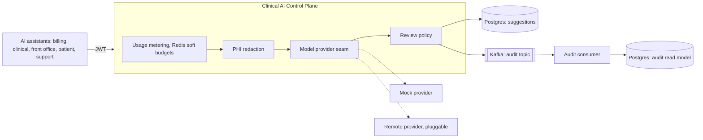

# Clinical AI Control Plane

A governance gateway that sits between clinical AI assistants and the model layer. It provides the
cross cutting capabilities that an assistant fleet needs in a healthcare setting: protection of
protected health information, per tenant cost and usage observability, configurable human review,
provenance for every output, and a complete audit trail.

The control plane is built to enable AI rather than to restrict it. The default posture is autonomy
with observability. Human review and hard budgets are policies that an operator can turn on where the
risk justifies them, not fixed gates applied to every request. The model call itself is thin and sits
behind a vendor neutral provider seam. The engineering value is in the governance plane around it.

## Architecture



## The governed flow

1. An assistant calls the gateway with a JWT carrying a tenant id and scopes.
2. The gateway meters the request and token usage per tenant for cost observability. It does not
   block by default.
3. Direct identifiers are redacted from the input before any model call.
4. The model is called through the provider seam. The mock provider is the default.
5. The suggestion is persisted with its provenance.
6. The review policy decides the next state. With autonomy, the default, the suggestion is auto
   approved. Where policy requires review, it stays PENDING for an authorized reviewer.
7. Every transition, automated or human, is published to Kafka and persisted by a separate consumer.

## Stack

Java 21, Spring Boot 3.3, Spring Web, Spring Security as an OAuth2 resource server, Spring Data JPA
with PostgreSQL and Flyway, Spring Data Redis, Spring Kafka, springdoc OpenAPI, JUnit 5, Mockito, and
Testcontainers. Build with Gradle. Container with Docker. Deploy with Helm to EKS provisioned by
Terraform.

## Run it locally

Prerequisites: Java 21, Docker, and Docker Compose.

Start the infrastructure (Postgres, Redis, single node Kafka):

```
docker compose up -d
```

Run the application with the dev profile, which enables a local token endpoint:

```
SPRING_PROFILES_ACTIVE=dev ./gradlew bootRun
```

Mint a development token:

```
TOKEN=$(curl -s "http://localhost:8080/dev/token" | sed -n 's/.*"access_token":"\([^"]*\)".*/\1/p')
```

Create a suggestion:

```
curl -s -X POST http://localhost:8080/api/v1/suggestions \
  -H "Authorization: Bearer $TOKEN" \
  -H "Content-Type: application/json" \
  -d '{
        "encounterId": "enc-1001",
        "assistantType": "BILLING",
        "inputText": "Patient SSN 123-45-6789 seen for acne follow up.",
        "groundingReferences": [
          {"sourceType": "ENCOUNTER", "sourceId": "enc-1001", "description": "visit note"}
        ]
      }'
```

With the default configuration the suggestion is auto approved, since no assistant requires review.
The response shows an APPROVED status and a decidedBy of policy:auto.

To see the human review path, start the application with review required for an assistant type:

```
REVIEW_REQUIRED_ASSISTANTS=BILLING SPRING_PROFILES_ACTIVE=dev ./gradlew bootRun
```

Now a BILLING suggestion is created in PENDING state and can be approved:

```
curl -s -X POST http://localhost:8080/api/v1/suggestions/<id>/approve \
  -H "Authorization: Bearer $TOKEN"
```

Read the API documentation at `http://localhost:8080/swagger-ui.html`.

## Run on Kubernetes (local)

The whole control plane, including its Postgres, Redis, and Kafka dependencies, runs on a local
single-node Kubernetes cluster ([minikube](https://minikube.sigs.k8s.io/)). This is the cloud-native
runnable proof of the system without provisioning any cloud resources. It uses the same Helm chart
under `helm/clinical-ai-gateway` that targets EKS in production.

```
deploy/local/up.sh
```

The script builds the application image as `clinical-ai-gateway:0.1.0`, starts minikube, loads the image,
deploys the dependencies, and installs the gateway via Helm. Every command is pinned to the
`minikube` context, so it cannot touch a remote cluster. Full instructions, including how to exercise
the API once it is up, are in [`deploy/local/README.md`](deploy/local/README.md). Tear down with
`deploy/local/down.sh`.

## Configuration

| Variable | Default | Purpose |
| --- | --- | --- |
| `MODEL_PROVIDER` | `mock` | Model backend. `mock` for local and tests, `remote` for a real backend. |
| `USAGE_MODE` | `monitor` | `monitor` records usage without blocking. `enforce` applies a hard budget. |
| `USAGE_RPM` | `600` | Per tenant request budget used for the soft warning and for enforce mode. |
| `REVIEW_REQUIRED_ASSISTANTS` | empty | Comma separated assistant types that require human review. Empty means autonomy. |

## Tests

```
./gradlew test
```

The unit tests cover redaction, usage metering in both monitor and enforce modes, and the
orchestration logic including the autonomous and review required paths. The integration test starts
Postgres, Kafka, and Redis with Testcontainers, drives the create and approve flow over HTTP with a
signed token, and waits for the audit consumer to persist the trail. Running the tests requires a
Docker daemon.

## Formatting

Formatting is checked by Spotless as a separate continuous integration job, so a fresh clone builds
green. Apply formatting before committing:

```
./gradlew spotlessApply
```

## Design decisions

The reasoning behind the architecture is recorded as architecture decision records:

- [ADR 0001: Centralized AI control plane](docs/adr/0001-centralized-ai-control-plane.md)
- [ADR 0002: Policy driven human review](docs/adr/0002-human-in-the-loop-approval-gate.md)
- [ADR 0003: Kafka for the audit trail](docs/adr/0003-kafka-audit-trail.md)
- [ADR 0004: PHI redaction at the gateway boundary](docs/adr/0004-phi-redaction-at-gateway.md)
- [ADR 0005: Vendor neutral model provider seam](docs/adr/0005-model-provider-abstraction.md)
- [ADR 0006: Usage metering and soft budgets, not hard rate limits](docs/adr/0006-usage-metering-not-hard-limits.md)

## Architecture process and planning

How an initiative moves from business strategy to a running system, with the artifacts produced at
each step:

- [Architecture process](docs/architecture/process.md): the phases from discovery to a hardened,
  scaled system, and why a mockup precedes the prototype.
- [Reviewer Console wireframes and API contract](docs/design/wireframes.md): the low-fidelity
  mockup that aligns stakeholders before any UI is built.
- [Delivery plan and backlog](docs/planning/backlog.md): the initiative decomposed into epics and
  vertically sliced tickets with acceptance criteria.

## Security note

The RSA key pair under `src/main/resources/keys` is a throwaway key used only to sign and verify
local development and test tokens. It must never be used outside local development. In a real
deployment the resource server validates tokens from a real identity provider, and secrets come from
a managed secret store.

## Scope

This is a focused reference implementation. The model call is mocked by default, the redaction is
pattern based and illustrative, and the remote provider is a stub that marks where a real model
client belongs. PHI redaction and the audit trail are always on, since they are data protection and
compliance concerns rather than limits on what the AI can do. These boundaries are intentional and
are documented where they occur.
