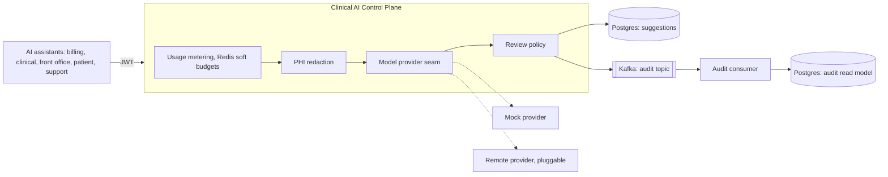

<div align="center">

<picture>
  <source media="(prefers-color-scheme: dark)" srcset="docs/assets/logo-dark.svg">
  
</picture>

# Clinical AI Control Plane

**A governance gateway between clinical AI assistants and the model layer.**

PHI redaction · per tenant cost observability · policy driven human review · provenance · full audit trail

[](https://github.com/thew0lf/clinical-ai-gateway/actions/workflows/ci.yml)


[Quick start](#quick-start) · [Architecture](#architecture) · [Technologies](#technologies) · [Documentation](#documentation)

</div>

---

The control plane sits between a fleet of clinical AI assistants (billing, clinical, front office, patient, support) and the model layer, and provides the cross cutting capabilities the fleet needs in a healthcare setting. It is built to **enable AI rather than to restrict it**: the default posture is autonomy with observability. Human review and hard budgets are policies an operator turns on where risk justifies them, not fixed gates applied to every request. The model call itself is thin and sits behind a vendor neutral provider seam; the engineering value is in the governance plane around it.

## Architecture



Every request passes through the same governed pipeline in the same order:

1. **Authenticate**: the JWT carries a tenant id and scopes; tenant isolation is applied at every query.
2. **Meter**: request and token usage is recorded per tenant for cost observability. It does not block by default.
3. **Redact**: direct identifiers are removed before any model call. Always on.
4. **Generate**: the model is called through the provider seam; the mock provider is the default.
5. **Persist**: the suggestion is stored with its grounding references and provenance.
6. **Decide**: the review policy auto approves by default, or holds the suggestion PENDING for a reviewer where policy requires it.
7. **Audit**: every transition, automated or human, is published to Kafka and persisted by a separate consumer.

Full detail with diagrams is in the [architecture portfolio](docs/pdf/Clinical-AI-Architecture-Portfolio.pdf).

## Quick start

```bash
docker compose up -d                            # Postgres, Redis, single node Kafka
SPRING_PROFILES_ACTIVE=dev ./gradlew bootRun    # run with the dev token endpoint enabled
TOKEN=$(curl -s "http://localhost:8080/dev/token" | sed -n 's/.*"access_token":"\([^"]*\)".*/\1/p')
curl -s -X POST http://localhost:8080/api/v1/suggestions \
  -H "Authorization: Bearer $TOKEN" -H "Content-Type: application/json" \
  -d '{"encounterId":"enc-1001","assistantType":"BILLING",
       "inputText":"Patient SSN 123-45-6789 seen for acne follow up.",
       "groundingReferences":[{"sourceType":"ENCOUNTER","sourceId":"enc-1001","description":"visit note"}]}'
```

The suggestion comes back auto approved by `policy:auto`, with the SSN redacted before the model ever saw it. API docs are at `http://localhost:8080/swagger-ui.html` once running.

The whole stack also runs on a local Kubernetes cluster with one command (`deploy/local/up.sh`), using the same Helm chart that targets EKS. See the [getting started guide](docs/getting-started.md) for the full walkthrough, the human review path, Kubernetes instructions, and tests. Configuration knobs and the security model are in [configuration and security](docs/configuration.md).

## Technologies

| Layer | Technology | Role |
| --- | --- | --- |
| Language and runtime | Java 21, Spring Boot 3.3, Gradle | Application platform |
| API | Spring Web, springdoc OpenAPI | Versioned REST contract at `/api/v1`, live docs at `/swagger-ui.html` |
| Security | Spring Security OAuth2 resource server | Stateless JWT verification, tenant claim, scope gated operations |
| Persistence | PostgreSQL, Spring Data JPA, Flyway | Suggestions, audit read model; schema by migration only |
| Metering | Redis, Spring Data Redis | Per tenant request and token counters, soft budgets |
| Audit stream | Apache Kafka, Spring Kafka | Durable audit topic with an independent consumer |
| Testing | JUnit 5, Mockito, Testcontainers, Awaitility | Unit and full stack integration tests, no cloud dependency |
| Quality | Spotless (google-java-format), Trivy | Formatting gate and vulnerability, secret, misconfig scanning in CI |
| Packaging | Docker | Multi stage image build |
| Orchestration | Kubernetes, Helm | One chart for the local minikube proof and the EKS target |
| Infrastructure | Terraform, AWS EKS | VPC and cluster as code |

## Documentation

### Document set (PDF)

Formal architecture documentation, generated from a single source and versioned with the code.

| Document | Contents |
| --- | --- |
| [Architecture Portfolio](docs/pdf/Clinical-AI-Architecture-Portfolio.pdf) | All five documents combined, with cover and table of contents |
| [CAG-01 Technical Architecture](docs/pdf/CAG-01-Technical-Architecture.pdf) | Layered design, the governed pipeline, state machine, security, API, deployment |
| [CAG-02 Architecture Diagrams](docs/pdf/CAG-02-Architecture-Diagrams.pdf) | System context, governed request flow, state machine, deployment topology |
| [CAG-03 Architecture Decision Records](docs/pdf/CAG-03-Architecture-Decision-Records.pdf) | Context, decision, and consequences for every load bearing choice |
| [CAG-04 Enterprise Standard](docs/pdf/CAG-04-Enterprise-Standard.pdf) | The layered contract, security posture, code quality bar, anti-pattern table |
| [CAG-05 Model and Redaction Research](docs/pdf/CAG-05-Model-and-Redaction-Research.pdf) | Model backend options, PHI de-identification options, hallucination posture |

### Guides

- [Getting started](docs/getting-started.md): run it locally, exercise both governance paths, run on Kubernetes, run the tests
- [Configuration and security](docs/configuration.md): every knob, the auth model, the CI pipeline

### Design decisions (ADR)

- [ADR 0001: Centralized AI control plane](docs/adr/0001-centralized-ai-control-plane.md)
- [ADR 0002: Policy driven human review](docs/adr/0002-human-in-the-loop-approval-gate.md)
- [ADR 0003: Kafka for the audit trail](docs/adr/0003-kafka-audit-trail.md)
- [ADR 0004: PHI redaction at the gateway boundary](docs/adr/0004-phi-redaction-at-gateway.md)
- [ADR 0005: Vendor neutral model provider seam](docs/adr/0005-model-provider-abstraction.md)
- [ADR 0006: Usage metering and soft budgets, not hard rate limits](docs/adr/0006-usage-metering-not-hard-limits.md)

### Process and planning

- [Architecture process](docs/architecture/process.md): the phases from discovery to a hardened, scaled system, and why a mockup precedes the prototype
- [Reviewer Console wireframes and API contract](docs/design/wireframes.md): the low fidelity mockup that aligns stakeholders before any UI is built
- [Delivery plan and backlog](docs/planning/backlog.md): the initiative decomposed into epics and vertically sliced tickets with acceptance criteria

## Scope

This is a focused reference implementation. The model call is mocked by default, the redaction is pattern based and illustrative, and the remote provider is a stub that marks where a real model client belongs. PHI redaction and the audit trail are always on, since they are data protection and compliance concerns rather than limits on what the AI can do. These boundaries are intentional and are documented where they occur.

## Author

Designed and built by **Guillermo (Bill) Cuevas**, Principal Software & Platform Architect. [LinkedIn](https://www.linkedin.com/in/guillermo-bill-cuevas/)
